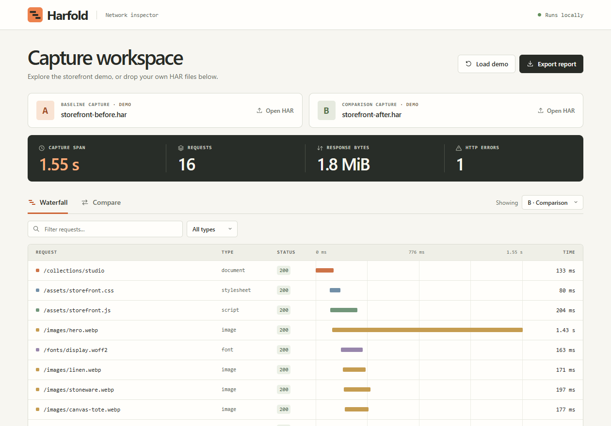

# Harfold

Turn a network regression into a check you can run on the next recording. Open a working and a broken HTTP Archive (HAR), select a request, then test a fresh capture. Harfold compares request waterfalls, response bytes, HTTP status and recorded JSON syntax on your device.

[Try the double-gzip case](https://kremefkaped.github.io/harfold/#json-demo) · [Download the offline app](https://github.com/kremefkaped/harfold/releases/latest/download/Harfold.html) · [简体中文](README.zh-CN.md) · [MIT license](LICENSE)



## Try the storefront case

Open the storefront workspace or the downloaded **Harfold.html** in a desktop browser. The two sample captures are already loaded. [Storefront workspace](https://kremefkaped.github.io/harfold/)

1. Select **Compare**. The storefront’s capture span grew by **794 ms**.
2. Open **/images/hero.webp**. Its request took **410 ms → 1.43 s**. The server wait stayed at 37 ms while receiving the image took an extra **1.02 s**.
3. Search for **503**. The new recommendations endpoint also failed in capture B.
4. Select **Export report** to save the Markdown comparison. It includes the full-capture metrics and up to 25 request pairs, independent of the screen filters.

## Turn a regression into a check for the next release

In **Compare**, open **/images/hero.webp** and select **Create acceptance check**. The byte rule is checked against both recordings before export. It passes the 142,000-byte baseline and fails the 1,284,000-byte regression. Save the JSON rule, then open **Acceptance check** to test another recording. **View task prompt** generates a repair brief locally and updates it after each candidate check.

Try it from the command line with the bundled files:

```sh
node cli.js examples/storefront-before.har examples/storefront-after.har --derive bytes --endpoint https://storefront.example/images/hero.webp > contract.json
node cli.js --check-contract contract.json examples/storefront-after.har
node cli.js --prompt contract.json examples/storefront-after.har
```

Replace the last HAR with a fresh capture after making a change. Use `--derive status` for a matched endpoint that changed from HTTP 2xx to 4xx or 5xx. Each check applies to exactly one occurrence of the method, origin and path. Query strings are ignored. Missing or repeated requests, skipped records or incomparable measurements yield **inconclusive**. Byte checks require a full HTTP 200 response, a positive size and the same measurement source. A different origin, dynamic URL or a strict ceiling equal to one baseline sample can limit reuse.

A broken image can be smaller than the budget and return HTTP 200. Pair the network check with an independent test of the actual image or application behavior. Run the seven-recording experiment to see this happen. [Experiment and reproduction steps](experiments/acceptance/)

### When HTTP 200 hides a broken response

In the double-gzip demo, choose **Larger working response** and click **Run case sample**. Repeat with **Wrong product value**. Both responses parse as JSON. Only one contains the expected product. The displayed functional result comes from a separate content assertion run for the case study. With your own candidate, you can supply the outcome of your independent test. Harfold uses that label to revise the repair prompt and keeps it out of the saved rule. [Original upstream fix](https://github.com/Kludex/starlette/pull/1901) · [Eleven-recording comparison](experiments/acceptance/gzip-case.md)

```sh
node cli.js good.har bad.har --derive json --endpoint https://shop.example/data.json > contract.json
node cli.js --prompt contract.json candidate.har --behavior broken
```

A JSON rule examines the included representation of one HTTP 200 JSON response, up to 1 MiB. Omitted, external or recognizably truncated bodies give an inconclusive result. The rule exports only the endpoint and the fixed syntax labels. A pre-existing test that knows the correct payload can check its values directly.

## Inspect your own release

Record the same interaction before and after a change. In Chrome DevTools, open **Network**, record the interaction, then choose **Export HAR (sanitized)**. Keep viewport, cache state and network settings consistent across runs. [Chrome’s HAR export guide](https://developer.chrome.com/docs/devtools/network/reference/#save-as-har)

Drop the earlier file onto **Baseline capture** and the later one onto **Comparison capture**. The first successful import clears both demo slots. A single file is enough for the waterfall. Select a request to inspect the origin, HTTP status, size and individual timing phases.

## Run in CI

Use Node.js 22 or newer. There are no packages to install.

```sh
node cli.js examples/storefront-before.har examples/storefront-after.har
node cli.js examples/storefront-before.har examples/storefront-after.har --json
```

Set the largest acceptable increase in capture span, in milliseconds. This example exits with code **1** because the recording grew by 794 ms.

```sh
node cli.js examples/storefront-before.har examples/storefront-after.har --max-span-increase 750
```

| Exit code | Meaning |
| --- | --- |
| 0 | Comparison succeeded and any supplied budget passed |
| 1 | Capture span exceeded its budget or the candidate failed its endpoint check |
| 2 | Invalid arguments, unreadable file or invalid capture |
| 3 | The candidate did not provide comparable evidence for its endpoint check |

To add the report to a GitHub Actions job summary, run the following step after checking out Harfold, setting up Node, and recording the two files in the working directory.

```yaml
- name: Check network regression
  shell: bash
  run: node cli.js before.har after.har --max-span-increase 250 >> "$GITHUB_STEP_SUMMARY"
```

## Read the measurements

| Measure | Definition |
| --- | --- |
| Capture span | Elapsed time from the first included request start to the last included finish. An interaction or a late poll can extend it beyond the page-load event. |
| Request match | HTTP method, URL origin and pathname. Repeated endpoints are paired by chronological occurrence. Query strings and fragments are ignored, so two requests invoked with different arguments can match. |
| Response bytes | The exporter’s transfer size when available, then response headers plus body size, then body size alone. An unknown request size makes the capture total unknown. |
| HTTP errors | Responses with HTTP status 400–599. Status 0 is displayed separately on the request and contributes zero to this count. |
| Timing phases | TLS is separated from connection setup. A request can have a reported total even when its phase breakdown is missing. |

The parser accepts HAR objects with a `log.entries` array. Each file can contain up to 50,000 entries and be up to 32 MiB. Unsupported protocols and incomplete entries are skipped and counted. Results display in batches of 100. The JSON CLI output contains all request pairs.

## Data handling

Captures stay in memory on your device. Harfold uses local assets, has no analytics, and makes no external requests. The exported reports retain hostnames and paths, which can contain customer IDs or internal service names. Headers, cookies, request and response bodies, URL credentials, query strings and fragments are excluded from the normalized records.

## Develop and distribute

```sh
node --test
node demo.js --check
node scripts/standalone.js
```

The last command builds **dist/harfold.html**, a portable single file you can attach to a release or send to a teammate. Open **index.html** directly while editing the source.

To host the app on GitHub Pages, publish the repository, then choose **Settings → Pages → Deploy from a branch → main → /(root)**. The repository root contains the complete static site. [GitHub Pages publishing guide](https://docs.github.com/en/pages/getting-started-with-github-pages/configuring-a-publishing-source-for-your-github-pages-site)

For bug reports, include the browser or Node version, the expected result, and a minimal synthetic HAR that reproduces the issue. The two files in `examples/` are safe starting points.

To try the same repair with a teammate, the organizer kit includes two independent workspaces and a separate verifier. [Handoff experiment and kit](experiments/acceptance/handoff-study.md)
