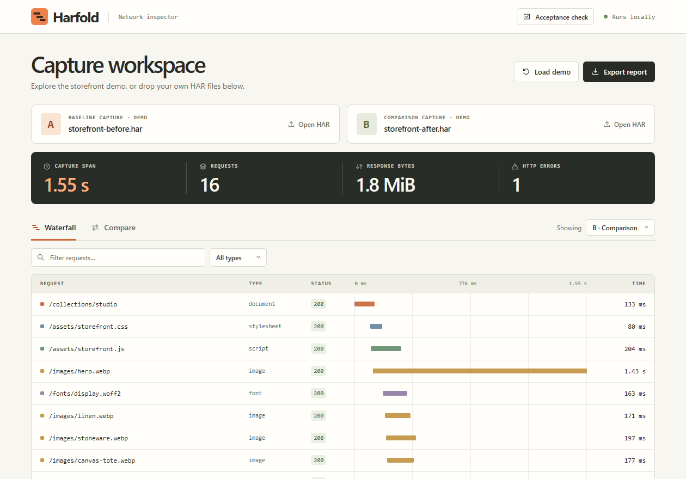

# Harfold

网页发布后变慢了，具体慢在哪个请求？把两次操作的 HAR 网络记录放进 Harfold，可以逐条比较耗时、下载大小和状态码，再把结果导出为适合贴到 Pull Request 的 Markdown。浏览器版支持离线使用，命令行版可以接入 CI。

[在线演示](https://kremefkaped.github.io/harfold/) · [直接试一次修复验收](https://kremefkaped.github.io/harfold/#acceptance-demo) · [English](README.md) · [示例文件](examples/) · [MIT 许可证](LICENSE)



## 一分钟复现一次性能回归

打开上方的在线演示，页面会自动载入一间虚构商店改版前后的两份记录。离线使用时，从 GitHub 下载项目 ZIP，解压后双击 **index.html** 即可。

1. 点击 **Compare**。从首个请求发出到最后一个请求完成，整段记录多用了 **794 毫秒**。
2. 点击 **/images/hero.webp**。它的体积从 **142,000 字节增加到 1,284,000 字节**，耗时从 **410 毫秒增加到 1.43 秒**。等待响应仍是 37 毫秒，多出的 1.02 秒都花在接收数据上。
3. 在筛选框输入 **503**，可以看到新版新增的推荐接口报错。
4. 点击 **Export report** 下载 Markdown，里面包含整份记录的指标和最多 25 组请求。搜索和筛选只影响屏幕上展示的行。

## 怎么知道修好了

在 **Compare** 中打开 **/images/hero.webp**，点击 **Create acceptance check**。页面会用改版前的 142,000 字节作为上限，先确认旧版通过、新版的 1,284,000 字节超限。保存 JSON 后，在 **Acceptance check** 中导入修复后的第三份抓包，即可复查同一条规则。点击 **View task prompt** 可以看到给开发者或 AI 的任务说明，它会随本次检查结果更新。

```sh
node cli.js examples/storefront-before.har examples/storefront-after.har --derive bytes --endpoint https://storefront.example/images/hero.webp > contract.json
node cli.js --check-contract contract.json examples/storefront-after.har
node cli.js --prompt contract.json examples/storefront-after.har
```

把后两条命令里的 HAR 换成修复后的记录即可。也可以用 `--derive status` 检查同一接口是否从 4xx 或 5xx 恢复为 2xx。每份记录中必须恰有一个方法、来源和路径相同的请求；查询参数不参与配对。请求缺失、重复、记录有跳过条目或计量口径变化，结果均为「证据不足」，退出码为 **3**。字节检查限于 HTTP 200、正字节记录，默认上限取自单次基线。

图片损坏后也可能变小、返回 HTTP 200。还要单独验证它能解码并显示预期内容。我们用七次由浏览器实际发起的本地访问复现了这个反例。[实验和复现步骤](experiments/acceptance/) · [中文研发记录](experiments/acceptance/research.zh-CN.md)

## 分析自己的网页

打开 Chrome 开发者工具的 **Network** 面板，操作一次网页，点击 **Export HAR (sanitized)** 保存。用相同的缓存状态、网络设置和操作步骤录制另一版本。 [Chrome 官方导出指南](https://developer.chrome.com/docs/devtools/network/reference/#save-as-har)

将旧版记录拖入 **Baseline capture**，新版记录拖入 **Comparison capture**。导入第一份自己的文件后，两份示例都会清空。只导入一份也能查看 **Waterfall**。点击请求可以查看来源、HTTP 状态、字节数，以及连接、等待和接收等阶段耗时。

## 命令行和自动检查

使用 Node.js 22 或更高版本，在项目目录中运行，无需安装第三方包。

```sh
node cli.js examples/storefront-before.har examples/storefront-after.har
node cli.js examples/storefront-before.har examples/storefront-after.har --json
node cli.js examples/storefront-before.har examples/storefront-after.har --max-span-increase 750
```

默认输出 Markdown，`--json` 导出所有配对请求。第三条命令把整段记录允许增加的时长设为 750 毫秒，内置示例超出预算，退出码为 **1**。检查通过时退出码为 **0**，输入或参数无效时为 **2**。GitHub Actions 步骤见[英文说明](README.md#run-in-ci)。

## 如何理解结果

- **记录跨度**从首个有效请求开始计至最后一个有效请求完成。后续交互或轮询也会延长这个指标。
- **请求配对**使用 HTTP 方法、协议、主机、端口和路径。同一地址出现多次时按开始时间依次配对，查询参数不同的请求也可能配成一组。
- **字节数**优先使用浏览器记录的传输大小，其次使用响应头和响应体大小之和，最后可回退到单独的响应体大小。有请求大小未知时，总计显示为「—」。
- **HTTP 错误**统计状态码 400–599，状态码 0 会保留在请求详情里。TLS 耗时从连接阶段中单独拆出。
- **文件上限**为每份 32 MiB、50,000 条记录。无法解析或使用其他协议的条目会跳过并计数，表格每批显示 100 行。

## 数据与分享

文件在本机内存中处理。页面使用本地资源，无统计服务。报告保留主机名和路径，分享前请检查其中的用户 ID 或内部服务名。请求头、Cookie、请求与响应正文、URL 用户名密码、查询字符串和片段都不会写入报告。

## 测试与发布

```sh
node --test
node demo.js --check
node scripts/standalone.js
```

最后一条命令会生成 **dist/harfold.html**，可以作为单文件版附在 GitHub Release 中。

发布时，将项目目录内的全部源文件（含 `.github`）推送到 GitHub 仓库根目录。在 **Settings → Pages** 中选择 **Deploy from a branch → main → /(root)** 并保存，即可发布在线演示。 [GitHub Pages 发布说明](https://docs.github.com/en/pages/getting-started-with-github-pages/configuring-a-publishing-source-for-your-github-pages-site)
